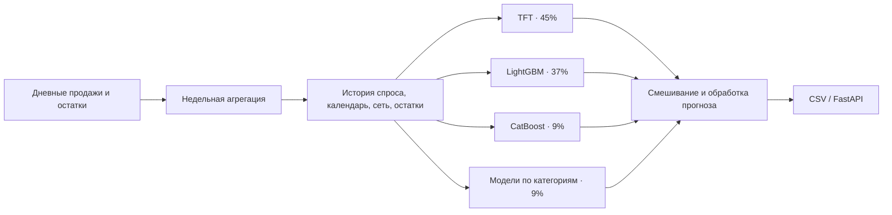

# Retail Demand Forecasting

Прогноз недельных продаж для 8 789 пар «склад — товар» на девять недель вперёд.
Проект объединяет подготовку данных, проверку моделей на временных окнах,
ансамбль нейросети и градиентного бустинга, а также API для получения прогнозов.

**Python · PyTorch · NeuralForecast · LightGBM · CatBoost · FastAPI**

Проект вырос из хакатона по прогнозированию спроса. В финал команда не прошла;
здесь сохранены рабочее решение, результаты экспериментов и выводы из разработки.
Это исследовательский проект с воспроизводимым инференсом, а не заявление
о готовности к эксплуатации в реальном бизнесе.

**[Запуск](docs/QUICKSTART.md) · [Устройство решения](docs/ARCHITECTURE.md) ·
[Результаты и ограничения](docs/RESULTS.md) · [Карта исследований](docs/EXPERIMENTS.md)**

## Задача

На входе — дневные продажи и остатки. На выходе — количество продаж по каждой
паре склада и товара для каждой будущей недели. Главные сложности: много нулей,
редкие всплески спроса, различия между товарами и изменение спроса во времени.
Тестовая дата отсечения — 26 июля 2026 года; прогноз — 27 июля — 21 сентября.

| Масштаб | Значение |
|---|---:|
| Склады | 11 |
| Товары | 799 |
| Горизонт | 9 недель |
| Строки итогового прогноза | 79 101 |
| Исторические окна оценки основного ансамбля | 5 |

## Решение

Основной сохранённый ансамбль использует TFT и табличные модели. Отдельно
исследованы NHITS, NBEATSx, Chronos-2 и Timestral-209M с LoRA. Последние
эксперименты с foundation-моделями описаны отдельно и не подменяют состав
сохранённого API.

## Результаты

Средние значения по пяти историческим окнам основного ансамбля:

| SMAPE ↓ | WAPE ↓ | RMSE ↓ | Bias abs ↓ | RMSLE ↓ |
|---:|---:|---:|---:|---:|
| 61.898% | 49.409% | 2.8784 | 75.407% | 0.5269 |

Источник — сохранённые метрики `Scale_1M_Dual_0.5`; подробности и поздние
эксперименты — в [таблице результатов](docs/RESULTS.md). Это локальная проверка,
не итоговое место в лидерборде. Исторические окна использовались при разработке,
поэтому результат нельзя считать оценкой на полностью нетронутом тесте.

На момент фиксации основной версии прогноз был воспроизведён из исходной истории:
**все 79 101 значения совпали**, локально прошли **13 тестов API**.
Dockerfile включён; успешная Docker-сборка в сохранённом манифесте не подтверждена.

## Посмотреть проект

- [Демонстрационные CSV](forecast-container/data) позволяют проверить сервис без полной истории соревнования.
- [Проверенный прогноз](delivery_final/submission.csv) и [манифест](delivery_final/manifest.json) фиксируют сданную версию.
- [Код инференса](forecast-container/app/predictor.py) содержит подготовку данных и вызов моделей.
- [Тесты API](forecast-container/tests/test_api.py) проверяют валидацию, кеш, даты и воспроизводимость.

Для запуска нужны Python 3.11 и зависимости сервиса. Пошаговые команды —
в [инструкции](docs/QUICKSTART.md). Полные исходные данные организаторов
не входят в репозиторий; без них нельзя повторить обучение и полную оценку.

## Что было сделано

- Объединение продаж и остатков с разной гранулярностью и обработкой пропусков.
- Признаки истории спроса, активности продаж, сетевых продаж и прошлых остатков.
- Проверка на последовательных временных окнах с отсечением будущих данных.
- Сравнение одиночных моделей, двухэтапного прогноза спроса и ансамблей.
- Дообучение предобученных временных моделей с проверками шкалы, квантилей и загрузки весов.
- Сохранение моделей и предоставление прогноза через CLI и HTTP API.

## Структура

| Путь | Содержание |
|---|---|
| `forecast-container/` | API, основной inference, веса, демоданные, Dockerfile |
| `docs/` | Документация портфолио и навигация |
| `delivery_final/` | Зафиксированный комплект сдачи |
| `experiments/` | Отчёты и результаты исследований |
| `submissions/` | Прогнозы разных кандидатов; не все относятся к основной версии |
| `train_*.py`, `run_*.py`, `evaluate_*.py` | Исторические скрипты обучения и оценки |

Скрипты исследования сохранены на прежних путях для совместимости. Старые
отчёты описывают состояние конкретного эксперимента и могут содержать выводы,
пересмотренные позднее. Начинать знакомство лучше с документации выше.

## Ограничения и дальнейшая работа

Улучшения от новых моделей были небольшими и зависели от периода. Более крупная
нейросеть не гарантировала лучший прогноз. Следующие инженерные шаги — единый
конфиг экспериментов, независимый финальный holdout, проверка Docker на чистой
машине и разделение исследовательских скриптов и библиотеки обучения.

Права на данные и сторонние веса остаются у их владельцев. Репозиторий
не предоставляет отдельного разрешения на распространение этих материалов.
