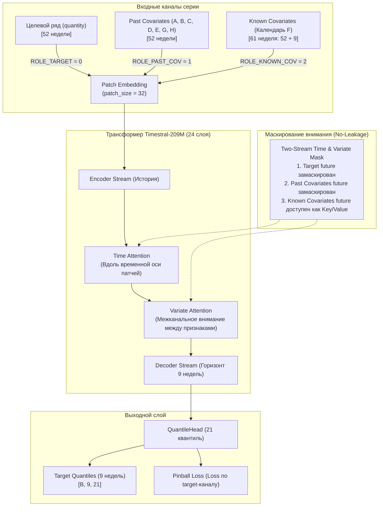

# Архитектура Native Covariate Conditioning в Timestral-209M

**Модель:** `mistralai/Timestral-209M`  
**Архитектура:** Patch-based Two-Stream Autoregressive Transformer with Variate Attention  
**Механизм адаптации:** Low-Rank Adaptation (LoRA: $r=8, \alpha=16$, модули `wQKV`, `wO`)  

---

## 1. Концепция многомерного кодирования

В классических авторегрессионных трансформерах временных рядов (таких как Chronos) модель работает исключительно с одномерным целевым рядом $y_t$.  
В `Timestral-209M` реализована нативная поддержка многомерных рядов и экзогенных ковариат через **двухпоточную матричную упаковку каналов (Packed Channel Rows)**.

Каждая временная серия со своими признаками представляется в виде набора параллельных рядов (каналов):
$$R_i = \{ \mathbf{x}_{target}, \mathbf{x}_{past}^{(1)}, \dots, \mathbf{x}_{past}^{(C_p)}, \mathbf{x}_{known}^{(1)}, \dots, \mathbf{x}_{known}^{(C_k)} \}$$

---

## 2. Роли каналов и маскирование внимания (Attention Roles)

Каждому ряду присваивается роль `role_id`:
1. `ROLE_TARGET (0)`: целевой ряд продаж. На горизонте прогноза декодируются токены запроса прогноза.
2. `ROLE_PAST_COV (1)`: исторические признаки (динамика продаж, остатки, выручка). На горизонте декодера эти каналы маскируются (`key_valid = False`), так как будущие значения неизвестны.
3. `ROLE_KNOWN_COV (2)`: календарные признаки и подтверждённые праздники. Они известны наперёд на все 9 недель горизонта. Их токены в декодере открыты для внимания, поэтому целевые токены прогноза могут напрямую считывать календарный контекст будущих недель!

---

## 3. Дифференцируемый цикл обучения (Differentiable LoRA Training)

Стандартный метод библиотеки `forecaster.forecast()` выполняется в режиме `torch.inference_mode()`.  
Для обеспечения сквозного обучения с градиентами разработан дифференцируемый конвейер через вызов `model.predict_block()`:

1. **Сборка каналов:** функция `_assemble_rows()` упаковывает целевые и ковариатные каналы, дополняя контекст 52 недели слева нулями до кратности `patch_size = 32` (длина $T_{pad} = 64$ патча).
2. **Патчевое масштабирование:** целевой ряд масштабируется каузально per-patch через `causal_patch_loc_scale()`. Известные ковариаты нормализуются через `_known_cov_scaling()`.
3. **Прямой проход:** `predict_block(inputs, observed, group_ids, horizon_patches=1, role_ids, known_future, known_future_mask)`.
4. **Селекция target-канала:** из выходов `(B * V, 32, 21)` извлекаются **исключительно** первые строки каждого батча (`:n_tgt = 1`) и первые 9 временных шагов горизонта (`:9`). Ковариатные строки отбрасываются и не получают потерь.
5. **Целевая функция:** `masked_pinball_loss_21_quantiles` по 21 соревновательному квантилю:
   $$\mathcal{L} = \frac{1}{B \cdot H \cdot Q} \sum_{b, h, q} \max \Big( q (y - \hat{y}_q), (q - 1)(y - \hat{y}_q) \Big)$$
6. **Градиенты LoRA:** оптимизируются адаптерные матрицы ранга 8 в слоях проекций внимания `wQKV` и `wO`.
